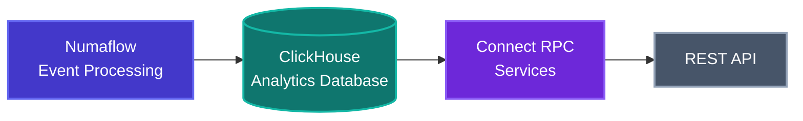

# halfback
Rugby event processing pipeline built with Numaflow, ClickHouse, Connect RPC, and Go.

## Architecture


## Local ClickHouse
Container: `halfback-clickhouse` (password: `halfback`)
Start after a reboot: `docker start halfback-clickhouse`
Recreate table from proto: `./scripts/setup-clickhouse.sh`

## Local Kubernetes (kind) + Numaflow
Cluster: `halfback` (created via `deploy/kind/kind-config.yaml`)
Recreate cluster: `kind create cluster --config deploy/kind/kind-config.yaml`
Install Numaflow into the cluster: `./scripts/setup-numaflow.sh`

### The pipeline
Manifest: `deploy/numaflow/halfback-pipeline.yaml` (source: simulator playing four matches, sink: ClickHouse writer)
Apply/update: `kubectl apply -f deploy/numaflow/halfback-pipeline.yaml`
Check status: `kubectl get pods`

Rebuild and reload an image after a code change, then restart its pod:
```bash
docker build -f pipeline/source/Dockerfile -t halfback-simulator:dev .   # or pipeline/sink, halfback-sink
kind load docker-image halfback-simulator:dev --name halfback            # match the tag above
kubectl delete pod -l numaflow.numaproj.io/vertex-name=in                # or vertex-name=out for the sink
```

ClickHouse is reached from inside the cluster via a Service/Endpoints pointing at the Docker `kind` network's gateway IP (see `deploy/clickhouse/service.yaml`). If the kind cluster is ever recreated, that IP may need updating — check with:
`docker network inspect kind -f '{{json .IPAM.Config}}'`

## Services (Connect v2)
All services read from ClickHouse, so it needs to be running (see above). Each one runs in its own terminal.

### MatchService
Run locally: `go run ./services/match` (listens on :50051)
Events for one match, keyed on `match_id`:
```bash
curl -s -X POST http://localhost:50051/halfback.match.v1.MatchService/ListMatchEvents \
  -H "Content-Type: application/json" \
  -d '{"match_id": "match-1"}'
```

### ScoreboardService
Run locally: `go run ./services/scoreboard` (listens on :50052)
Per-match event count and home, away and total points (only events with a team are counted):
```bash
curl -s -X POST http://localhost:50052/halfback.scoreboard.v1.ScoreboardService/ListMatches \
  -H "Content-Type: application/json" \
  -d '{}'
```

## API (REST via Vanguard)
Run locally: `go run ./api` (listens on :8080)
Requires MatchService and ScoreboardService running.

```bash
curl -s http://localhost:8080/v1/matches
curl -s http://localhost:8080/v1/matches/match-1/events
```

## Protos
- `proto/halfback/events/v1`: pipeline/storage schema (ClickHouse tables are inferred from this)
- `proto/halfback/match/v1`, `proto/halfback/scoreboard/v1`: internal service contracts
- `proto/halfback/api/v1`: public contract, with `google.api.http` annotations for REST

Regenerate code after editing a proto: `buf generate`